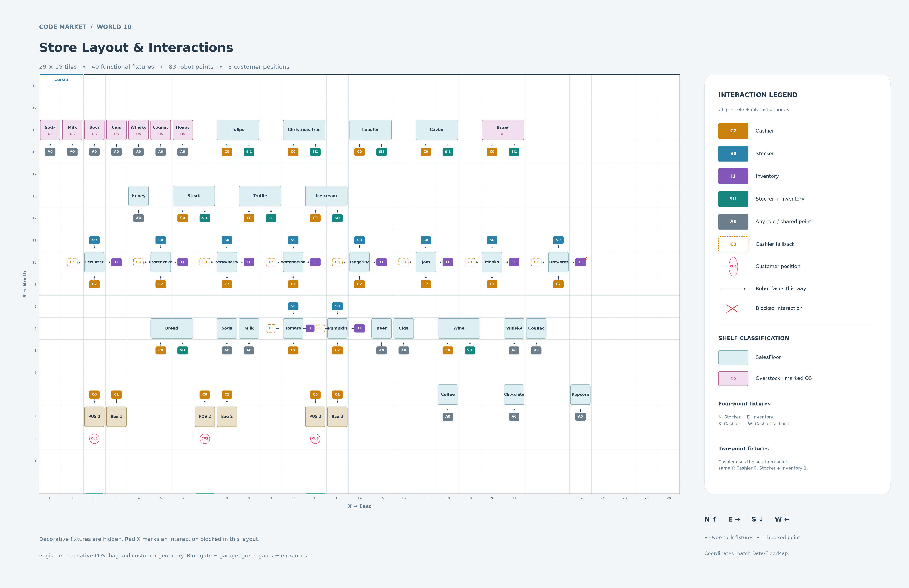
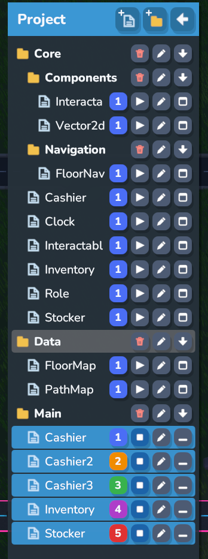

# Personal Code Market scripts

My current robot scripts for Code Market, with shared components, store data, and precomputed walking routes.



[Full-size PNG](maps/FloorMap.png) · [SVG](maps/FloorMap.svg). Decorations are omitted from the image.

## Scripts

| Entry script | Job |
| --- | --- |
| `Main/Cashier` | Serves register **1**. |
| `Main/Cashier2` | Serves register **2**. |
| `Main/Cashier3` | Serves register **3**. |
| `Main/Inventory` | Orders deliveries, prioritizing SalesFloor shortages before Overstock refills and accounting for existing stock, incoming goods, money, and truck capacity. |
| `Main/Stocker` | Unloads deliveries and fills SalesFloor shelves before Overstock. |

Cashiers collect orders, bag goods, check age and alcohol sale hours, and retry missing products before removing unavailable items. Their robot consoles show order progress, stock checks, retry countdowns, and completion. Inventory prints each successful delivery's total and grouped product quantities. Stocker prints loading and restocking progress.

## Layout

```text
cs/
  Core/          Shared classes, enums, components, and navigation
  Data/          FloorMap and PathMap
  Main/          Robot entry scripts
maps/
  FloorMap.png   Store layout and interaction legend
  FloorMap.svg   Scalable version of the same map
```

## Use in the game


Assign each cashier robot its matching numbered entry script. Assign the other robots `Main/Inventory` and `Main/Stocker`. Shared files under `Core/` and `Data/` supply their dependencies.



